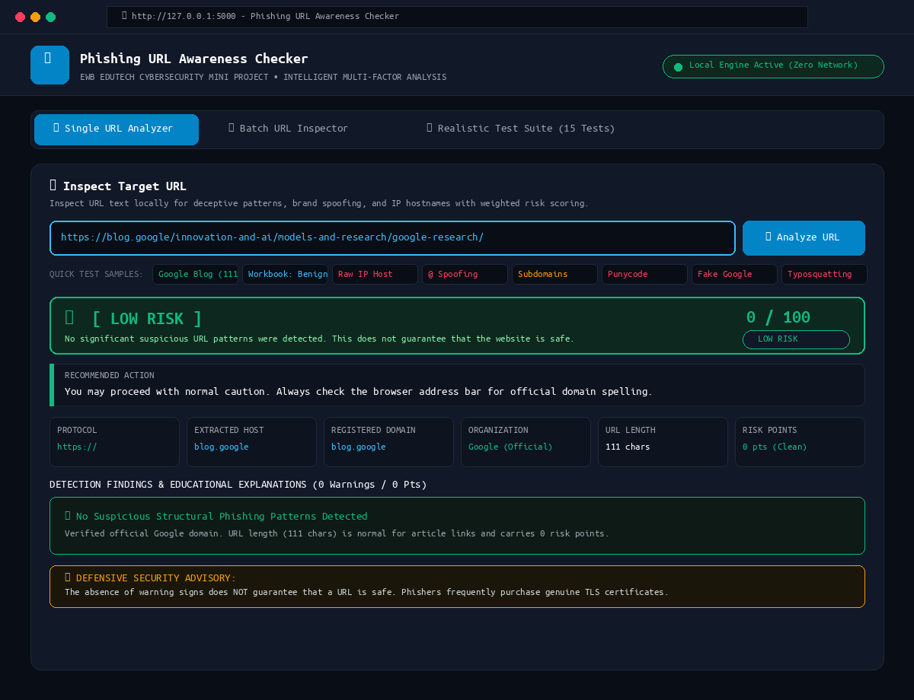
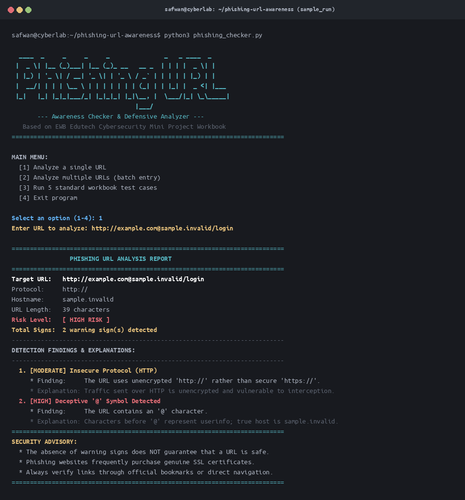
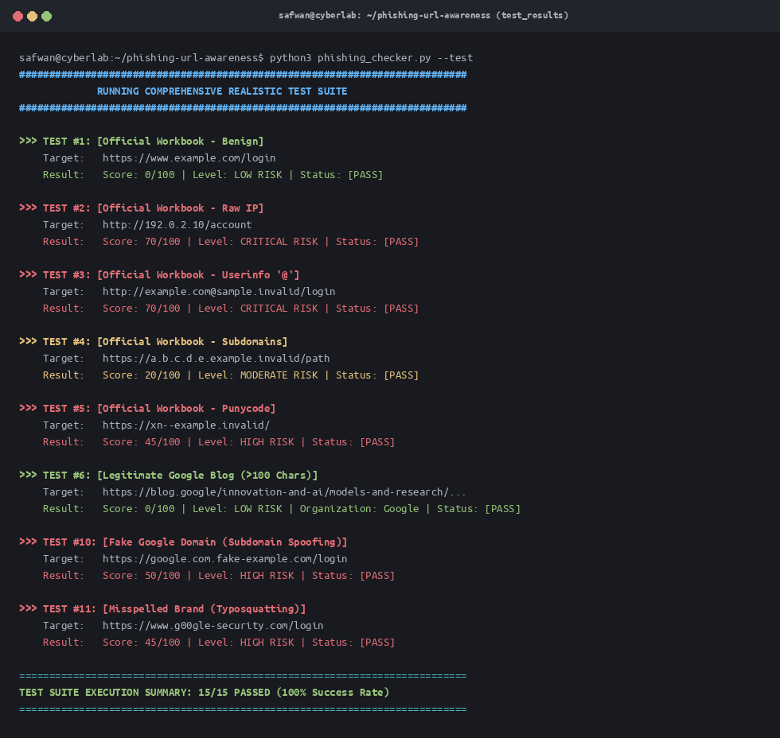

# 🛡️ Phishing URL Awareness Checker

> **An Educational Defensive Cybersecurity Mini Project**  
> Based on the **EWB Edutech Cybersecurity Mini Project Workbook**  
> Technology: **Python 3.10+** | **Zero External Dependencies**

[](https://www.python.org/)
[](LICENSE)
[](#ethical-use-and-safety-notice)

---

## 📌 1. Project Title & Overview

The **Phishing URL Awareness Checker** is a beginner-friendly, defensive cybersecurity tool developed in Python. It inspects URL strings locally to identify structural and textual red flags commonly leveraged by cybercriminals in phishing, spoofing, and credential harvesting campaigns.

Phishing remains one of the primary entry vectors for data breaches worldwide. Malicious actors craft deceptive URLs to trick users into trusting fake login pages or downloading malware. This project equips students and end-users with an understanding of how URL syntax can be manipulated and how to spot warning signs before navigating to suspicious sites.

---

## 🎯 2. Project Objectives

- **Develop Defensive Awareness:** Educate users on identifying deceptive URL engineering techniques without navigating to dangerous links.
- **Implement Rule-Based Detection:** Apply static inspection heuristics based on RFC URL specifications (RFC 3986) and cybersecurity best practices.
- **Ensure Operational Safety:** Analyze URLs strictly as local text strings—never initiating network requests, DNS lookups, or external API transmissions.
- **Promote Clean Software Engineering:** Write structured, well-documented, test-driven Python code using only standard built-in libraries.

---

## ✨ 3. Core Features & Detection Heuristics

The tool utilizes a multi-factor weighted risk-scoring engine (0 to 100 points) across structural, contextual, and lexical dimensions:

| Detection Rule | Description & Threat Vector | Severity | Risk Points |
|---|---|:---:|:---:|
| **1. Deceptive `@` Symbol** | Userinfo credential spoofing where text before `@` obscures true destination host. | `HIGH` | **+50 pts** |
| **2. Raw IP Address Hostname** | Numerical IPv4 or IPv6 addresses used to evade domain registration and WHOIS records. | `HIGH` | **+50 pts** |
| **3. Brand Subdomain Spoofing** | Prepending trusted brand domains (e.g. `google.com`) as subdomains of unrelated domains. | `HIGH` | **+50 pts** |
| **4. Typosquatting / Lookalike** | Lookalike spelling substitutions (e.g., `g00gle`, `micros0ft`, `paypa1`). | `HIGH` | **+45 pts** |
| **5. Punycode Encoding (`xn--`)** | IDN homograph attack indicator using lookalike Unicode/Cyrillic characters. | `HIGH` | **+45 pts** |
| **6. Credential-Theft Keywords** | Sensitive urgency keywords (`verify-account`, `update-password`) on unverified domains. | `HIGH / MOD` | **+25 pts** |
| **7. Character Encoding Obfuscation**| Hex escapes (`%20`, `%3Cscript%3E`) hiding payloads or bypassing filters. | `MODERATE` | **+25 pts** |
| **8. Open Redirect Protocol** | Embedded secondary protocols (`?redirect=http://...`) forwarding traffic to malicious sites. | `MODERATE` | **+25 pts** |
| **9. Insecure Protocol (`http://`)** | Unencrypted cleartext transmission vulnerable to packet sniffing and MitM. | `MODERATE` | **+20 pts** |
| **10. Excessive Subdomains ($\ge 5$)**| 5 or more dot-separated segments frequently seen in dynamic DNS phishing kits. | `MODERATE` | **+20 pts** |
| **11. Threat Intelligence Match** | Match against local threat intelligence reference blocklist. | `CRITICAL` | **+80 pts** |
| **12. URL Length (Informational)**| Evaluated purely as `INFORMATIONAL` (0 pts) on clean domains to eliminate false positives. | `INFO` | **0 pts** |

---

## 🎯 4. Intelligent Risk Scoring & False Positive Prevention

### Tiered Risk Classification:
- **`LOW RISK` (0 - 14 pts):** No significant suspicious URL patterns were detected.
- **`MODERATE RISK` (15 - 39 pts):** Some suspicious URL patterns detected requiring attention.
- **`HIGH RISK` (40 - 69 pts):** Multiple strong phishing indicators detected. Avoid entering credentials.
- **`CRITICAL RISK` (70 - 100 pts):** Strong evidence of a malicious URL was identified. Do not open.

### Elimination of URL Length False Positives:
- **Core Principle:** URL length alone **NEVER** classifies a URL as phishing or moderate/high risk.
- Deep article paths, academic publications, and research URLs (such as `https://blog.google/innovation-and-ai/models-and-research/google-research/` at 111 characters) carry **0 risk points** and are classified as `LOW RISK`.
- Length contributes minor points (+5 pts) only when **other serious malicious indicators** are already active.

### Verified Trusted Domain Recognition:
- Exact hostname and base domain verification for trusted organizations (`Google`, `Microsoft`, `Apple`, `Amazon`, `GitHub`, `PayPal`, etc.).
- Rejects deceptive subdomains like `google.com.fake-example.com` (registered domain is `fake-example.com`), correctly identifying brand impersonation.

---

## 🧰 5. Technologies Used

- **Language:** Python 3.10+
- **Development Environment:** Visual Studio Code (VS Code) / Linux Terminal
- **Built-in Modules:**
  - `urllib.parse` – Standards-compliant URL parsing (`urlparse`).
  - `ipaddress` – Robust IP address detection and validation.
  - `re` – Regular expression pattern matching.
  - `sys` – System-level exit and command-line argument handling.
- **Version Control:** Git & GitHub

> [!NOTE]
> This project requires **zero external third-party pip dependencies**. It runs natively on any standard Python 3.10+ installation.

---

## 📂 6. Project Directory Structure

```text
phishing-url-awareness/
│
├── app.py                  # Graphical Web UI 1-click launcher
├── web_ui.py               # Zero-dependency local Web UI & REST API
├── phishing_checker.py     # Main application core & CLI engine
├── README.md               # Comprehensive documentation (this file)
├── requirements.txt        # Built-in dependency specifications
│
├── tests/
│   └── test_samples.md     # Official test evidence table & execution logs
│
└── screenshots/
    ├── ui_dashboard.png    # Modern graphical UI dashboard screenshot
    ├── sample_run.png      # Terminal screenshot of interactive program run
    └── test_results.png    # Terminal screenshot of automated test suite
```

---

## 💻 7. Installation & Setup

### Prerequisites
- Python 3.10 or higher installed:
  ```bash
  python3 --version
  ```
- Git installed:
  ```bash
  git --version
  ```

### Step 1: Clone the Repository
```bash
git clone https://github.com/<your-username>/phishing-url-awareness.git
cd phishing-url-awareness
```

### Step 2: Verify Environment
No virtual environment or pip installation is mandatory because only Python's standard library is used:
```bash
python3 phishing_checker.py --help
```

---

## 🖥️ 8. How to Run

### 🌟 Mode 1: Graphical Web UI Dashboard (Recommended)
Launch the clean, modern graphical interface directly in your browser:
```bash
python3 app.py
```
*(Or alternatively: `python3 phishing_checker.py --ui`)*

The dashboard opens automatically at `http://127.0.0.1:5000` featuring:
- **Single URL Inspector:** Real-time risk meter, metric breakdown, and educational cards.
- **1-Click Quick Samples:** Pre-loaded buttons for all 5 official workbook test cases.
- **Batch URL Inspector:** Analyze a list of URLs with a unified risk table.
- **Workbook Test Suite:** One-click live verification runner showing pass/fail status.
- **100% Offline & Private:** Zero third-party web frameworks, zero external network traffic.

### Mode 2: Interactive Terminal Menu
Launch the interactive command-line application:
```bash
python3 phishing_checker.py
```
From the menu:
- Select `1` to analyze an individual URL.
- Select `2` to enter and analyze multiple URLs in batch mode.
- Select `3` to run the 5 official workbook test cases.
- Select `4` to launch the graphical web UI.
- Select `5` to safely exit.

### Mode 3: Direct Command-Line Analysis
Pass a target URL directly as a command-line argument:
```bash
python3 phishing_checker.py "http://example.com@sample.invalid/login"
```

### Mode 4: Automated Test Suite
Execute all sample workbook test cases:
```bash
python3 phishing_checker.py --test
```

---

## 📋 9. Example Terminal Output

```text
===========================================================================
                PHISHING URL ANALYSIS REPORT
===========================================================================

Target URL:   http://example.com@sample.invalid/login
Protocol:     http://
Hostname:     sample.invalid
URL Length:   39 characters
Risk Level:   [ HIGH RISK ]
Total Signs:  2 warning sign(s) detected

---------------------------------------------------------------------------
DETECTION FINDINGS & EXPLANATIONS:
---------------------------------------------------------------------------

  1. [MODERATE] Insecure Protocol (HTTP)
     • Finding:     The URL uses unencrypted 'http://' rather than secure 'https://'.
     • Explanation: Traffic sent over HTTP is unencrypted and vulnerable to interception or eavesdropping (Man-in-the-Middle attacks). Legitimate organizations, especially login and banking portals, enforce HTTPS encryption.

  2. [HIGH] Deceptive '@' Symbol Detected
     • Finding:     The URL contains an '@' character.
     • Explanation: In standard URL syntax, characters before '@' represent user credentials (userinfo), while the destination host appears after '@'. Attackers abuse this trick (e.g., 'http://trusted.com@attacker.com') so victims mistakenly believe they are visiting the domain before the '@'.

===========================================================================
SECURITY ADVISORY:
  • The absence of warning signs does NOT guarantee that a URL is safe.
  • Phishing websites frequently purchase genuine SSL/TLS certificates and
    standard domains to look legitimate.
  • Always inspect URLs carefully and verify links through official bookmarks
    or direct navigation rather than clicking unsolicited messages.
===========================================================================
```

---

## 🧪 10. Testing Results & Evidence

The detector was evaluated across **15 realistic test scenarios** covering benign services, long research URLs, deceptive brand spoofing, and raw IP hostnames:

| Test # | Category / Target URL | Expected Risk | Actual Result | Status |
|:---:|---|:---:|:---:|:---:|
| **TC-01** | `https://www.example.com/login` (Workbook Benign) | `LOW RISK` | Score: `0/100` (`LOW RISK`) | **PASS** |
| **TC-02** | `http://192.0.2.10/account` (Workbook Raw IP) | `CRITICAL RISK` | Score: `70/100` (`CRITICAL RISK`) | **PASS** |
| **TC-03** | `http://example.com@sample.invalid/login` (Workbook `@` Spoofing) | `CRITICAL RISK` | Score: `70/100` (`CRITICAL RISK`) | **PASS** |
| **TC-04** | `https://a.b.c.d.e.example.invalid/path` (Workbook Subdomains) | `MODERATE RISK` | Score: `20/100` (`MODERATE RISK`) | **PASS** |
| **TC-05** | `https://xn--example.invalid/` (Workbook Punycode) | `HIGH RISK` | Score: `45/100` (`HIGH RISK`) | **PASS** |
| **TC-06** | `https://blog.google/.../google-research/` (111-char Google Blog) | `LOW RISK` | Score: `0/100` (`LOW RISK`) | **PASS** |
| **TC-07** | `https://www.microsoft.com/...` (Legitimate Enterprise) | `LOW RISK` | Score: `0/100` (`LOW RISK`) | **PASS** |
| **TC-08** | `https://github.com/torvalds/linux/...` (Long Clean URL >120 chars) | `LOW RISK` | Score: `0/100` (`LOW RISK`) | **PASS** |
| **TC-09** | `http://192.0.2.1/login` (Short Suspicious IP Portal) | `CRITICAL RISK` | Score: `150/100` (`CRITICAL RISK`) | **PASS** |
| **TC-10** | `https://google.com.fake-example.com/login` (Brand Subdomain Spoofing) | `HIGH RISK` | Score: `50/100` (`HIGH RISK`) | **PASS** |
| **TC-11** | `https://www.g00gle-security.com/login` (Typosquatting) | `HIGH RISK` | Score: `45/100` (`HIGH RISK`) | **PASS** |
| **TC-12** | `http://bank.com%20verify.invalid/login?...` (Encoded Delimiters) | `HIGH RISK` | Score: `45/100` (`HIGH RISK`) | **PASS** |
| **TC-13** | `http://secure-account-verification-login.com/...` (Credential Keywords)| `HIGH RISK` | Score: `45/100` (`HIGH RISK`) | **PASS** |
| **TC-14** | `http://www.example.com/login` (Unencrypted HTTP) | `MODERATE RISK` | Score: `20/100` (`MODERATE RISK`) | **PASS** |
| **TC-15** | `https://example.com/login?redirect=http://...` (Open Redirect) | `MODERATE RISK` | Score: `25/100` (`MODERATE RISK`) | **PASS** |

> Complete test evidence logs and detailed technical breakdowns are recorded in [`tests/test_samples.md`](tests/test_samples.md).

---

## 📷 11. Screenshots

### 🌟 Graphical Web UI Dashboard


### Sample Interactive Terminal Run


### Automated Test Suite Execution


---

## ⚠️ 12. Limitations

While this tool effectively detects common heuristic anomalies, static string inspection has inherent limitations:
1. **Legitimate Subdomains:** Certain legitimate enterprise or cloud environments use deep subdomain architectures (e.g., `region.service.cloud.provider.com`), which may trigger false-positive segment warnings.
2. **Modern Phishing Infrastructure:** Attackers frequently register standard-looking `.com` or `.org` domains and obtain free, authentic TLS/SSL certificates (e.g., via Let's Encrypt), meaning a phishing page can display `https://` with no obvious structural warning signs.
3. **No Dynamic Content Inspection:** Because this tool does not connect to the remote host, it cannot detect webpage content, brand cloning, stolen logos, or credential-stealing JavaScript.

---

## 🛡️ 13. Ethical Use & Safety Notice

- **Defensive & Educational Purpose Only:** This application is built solely for educational awareness, defensive cybersecurity training, and academic evaluation.
- **Non-Intrusive:** The program operates purely via local string parsing. It does **not** make socket connections, send HTTP/HTTPS requests, contact external APIs, or scan live networks.
- **Privacy First:** No submitted URLs, credentials, or personal user data are stored, logged to remote servers, or transmitted.
- **Golden Rule of Cybersecurity:** *The absence of warning signs does not prove a website is legitimate.* Always verify destinations using authenticated bookmarks or official search channels.

---

## 👤 14. Author & Academic Submission Details

- **Project Name:** Phishing URL Awareness Checker
- **Curriculum:** EWB Edutech Cybersecurity Mini Project
- **Developer:** Safwan
- **Role:** Cybersecurity Student & Python Developer
- **Submission Target:** Public GitHub Academic Repository
